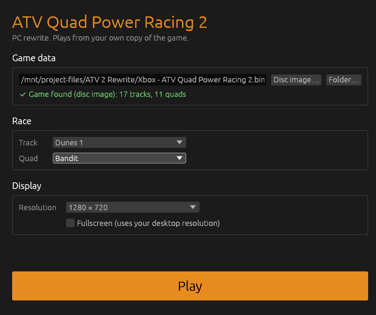

# ATV Quad Power Racing 2: PC rewrite

A from-scratch PC version of the 2003 Xbox game, written in Rust with Bevy.
**No game data is included or distributed.** Everything is loaded at runtime
from the player's own copy of the game: the Xbox disc image (`.iso`/`.bin`)
or a folder the disc was extracted to.

## Crates

| Crate | What it does |
|---|---|
| `atv-formats` | Engine-free readers: Xbox disc filesystem, "Bark" archive + LZSS, BOG textures (DXT1/DXT5, swizzled ARGB, 8-bit palettized), BED sprite sheets and bitmap fonts, ROM 1.26 models (meshes + Bezier patches), ROW 2.25 track worlds, `Setup/*.xml` rule files. |
| `atv-sim` | Engine-free vehicle physics ported from the original game (see `docs/physics.md`): reads the game's `.params` tuning files, spring-strut wheels, body-level ground forces, auto gearbox, wheelies, preload jumps, air control, and track collision built from the track's meshes and patches. |
| `atv-tool` | Command line: `list`, `extract <dir>`, `check` (parses every texture, model and track), `sim` (headless autopilot lap test). |
| `atv-game` | The game (binary `atv2`): the original front end (title, main menu, rider / ATV / track select, the race loading screen with the track's picture and a racing tip) into a race with the original HUD (rev gauge, the race panels with place, trick score, lead and lap times, lap meter, 3-2-1-GO countdown, checkpoint and wrong-way banners, pause and results menus); Single Race, Time Trial, Career, Arcade, Open Freestyle, ATV Academy and split-screen multiplayer modes; computer riders; tricks with the original stunt animations; a drivable quad with its rider on any track, chase camera, keyboard and gamepad input. |
| `atv-hd` | HD texture packs: upscales the game's own textures with an AI upscaler (Real-ESRGAN) on the player's machine into a local cache the game prefers when present. |
| `atv-launcher` | The launcher (binary `atv2-launcher`): pick your disc image or extracted folder once, choose track, quad, resolution and fullscreen, press Play. |

## Running

The easy way is the launcher. Build both binaries so they sit side by side,
then run the launcher:

```
cargo build --release -p atv-game -p atv-launcher
./target/release/atv2-launcher
```



It checks your game data with the same loader the game uses, lists the tracks
and quads it finds, remembers your choices, and starts `atv2` for you. If the
game fails to start, its last error lines show in the launcher.

From the command line:

```
# Point at your own disc image (or extracted folder)
export ATV2_GAME="/path/to/ATV Quad Power Racing 2.bin"

cargo run --release -p atv-tool -- check
cargo run --release -p atv-game                     # front end
cargo run --release -p atv-game -- --track Dunes1 --quad Bandit --rider Male1 --laps 3   # straight into a race
cargo run --release -p atv-tool -- sim --track Dunes1 --quad Bandit --seconds 120
cargo run --release -p atv-tool -- race --track Dunes1 --riders 4 --laps 2   # AI-only race, prints lap times
```

| Action | Keyboard | Gamepad |
|---|---|---|
| Throttle | W / Up | RT or A |
| Brake / reverse | S / Down | LT or X |
| Steer | A / D | Left stick |
| Lean back / forward | I / K | Left stick up/down |
| Jump (preload) | Space | RB or B |
| Speed boost | Shift | Y (on the ground) |
| Kick | E | LB (on the ground) |
| Respot | R | |
| Restart | Backspace | |
| Pause | Escape | Start |
| Tricks (in the air) | 1 / 2 / 3 / 4 + direction | X / Y / LB / RB + left stick or D-pad |

The pause menu is the original's: Audio, Camera and Controller (the Options
pages, changed mid-race; the music and ambience follow at once), Return to
Race, Restart and Quit Race.

## Game modes

- **Single Race**: pick rider, ATV, track and laps, then race five computer
  riders (`--opponents N` for 0-7). They drive the original game's AI along
  each track's racing line. As in the original, the top left shows your
  place, your trick score and your lead over second place (or how far the
  leader is ahead), and the top right the lap you're on, its time and your
  best lap; the lap meter shows everyone's place. The results are the
  original's page: everyone in the order they finished with their time and
  trick points (riders still out are brought home at their pace so far),
  and a box turning through the race's best lap, longest jump, biggest air,
  wheelie and bicycle with who set them and their face. Continue asks
  "Race Again?". In a career round the trick score also shows your place
  for tricks, which earns championship points.
- **Time Trial**: the same without opponents, against the clock and, as in
  the original, the ghost of the best lap on the track: a see-through quad
  and rider that sets off with you every lap. A lap faster than the
  ghost's becomes the ghost. Each track keeps its ghost between sessions
  (`ghosts/<track>.ghost` in the config folder), on the rider and ATV that
  set it. The times show the track's lap record, your best lap and, as
  in the original, your last three laps above the lap you're riding. The
  results are the original's Time Trial page: your five fastest laps and
  the track's lap record with who holds it.
- **Career**: the Amateur, Qualifying and Professional championships of
  `Setup/Career.xml`, five rounds each against seven computer riders, with
  race and trick points, skill points, gold medals and ATV unlocks; a top-3
  finish opens the next. With a profile loaded you ride its rider, as in
  the original. Professional opens **Custom**, as in the original:
  after ATV select, Choose Your Tracks lists the championship tracks
  you've opened (A adds the highlighted one as the next round or takes it out,
  Right then Up/Down sets its laps from 1 to 20, Y or Continue goes on),
  and Point Distribution shares each place's race and trick points out
  between the race and the trick ranking in 5% steps (Left/Right). Custom
  rounds earn skill points but no medals. After each round the original's
  results page lists the field three ways, Up and Down turning between
  them: by finishing order with times and race points, by trick score with
  the trick ranking's bonuses, and by championship points with the round's
  total and the career total. A round summary with skill points and unlocks
  follows.
- **Arcade**: the 15 rounds of the disc's `Setup/Arcade.xml` back to back
  (the disc lists a sixteenth, Dunes 1 again, which the original never races).
  Each round is one lap, as in the original. The clock starts at the
  track's arcade time (40 or 45 s), and each arcade checkpoint adds the
  seconds the track gives it (10 to 30). Win a round (finish first, in time)
  for the next one; each round allows three attempts, and losing the third
  sends Arcade back to round 1 (the disc's "You need to finish in first
  place to move onto the next round" and "Attempts: %d/3"). Seven computer riders race each round, as in the
  original (its arcade mode seats 1 player and 7 AI).
  The field carries on from round to round as in the original: a new game
  starts you at the back of the weakest riders, each round's finishing
  order is the next round's grid, and the last three go out for three new
  riders, drawn nearer the top of the rankings as the rounds go on. Arcade
  Status shows the grid (new riders in green), each rider's ranking and who
  went out before every round, and Arcade Complete the final order after
  the fifteenth.
  The next round and its field are saved after each one (`arcade` in the
  profile, the original's `mArcadeProgress`); choosing Arcade then offers
  to continue from it or start a new game. With a profile loaded you ride
  its rider.
  Each round ends on the original's Arcade results page, the field's
  finishing order and times with the race's bests below.
- **Open Freestyle**: roam any track for points against a time limit (1, 3,
  5, 10, 15 or 30 minutes, or unlimited) with the disc's Bronze, Silver and
  Gold targets. Points come from tricks, multi-trick combos, flips and spins,
  big air, wheelies, endos and bicycles, the Stadium trick boxes (Cage Jump,
  Bus Leap, Hoopa...) and the first visit to each of the track's spots.
  As in the original, the top left lists the time limit's Gold, Silver and
  Bronze scores beside their medals, your score taking its place among
  them (in orange) once it beats one, and the top right shows the clock
  (only with a time limit) and your score, rolling up to the points you've
  earned. When the session ends, the original's results page lists your
  trick points, longest endo, best trick combo and what it scored, with the
  session's bests below, then asks "Try Again?".
- **ATV Academy**: the original's training mode. Pick an ATV (with a
  profile loaded you ride its rider) and practise on Stadium 2, scoring as
  in Open Freestyle but with no time limit or medal targets (the score
  shows top left), until you quit from the pause menu.
- **Multiplayer**: split-screen Single Race for two to four players (two
  split left and right on a widescreen window, as the original in
  widescreen, or top and bottom on a 4:3 one; three or four take a quarter
  each), with computer riders making the field up to four. Every player's
  view has the full race HUD with their own figures (gauge, place, laps,
  lap meter, countdown and banners), shrunk to fit a half-height or
  quarter view. Each player picks a rider (one
  another player has is greyed out) and an ATV in turn. Player 1 drives
  with WASD (lean R/F, preload Space, boost left Shift, kick E) or the first pad, player 2 with the
  arrow keys (lean Numpad 8/5, preload right Shift, boost Numpad 0, kick Numpad 6) or the second pad, and
  players 3 and 4 with the third and fourth pads. Once the first player is
  home the others get a minute to finish. Freestyle Battle puts the same
  players on a track against a time limit with no computer riders; the
  most points wins. As in the original, its results page is Open
  Freestyle's, titled Freestyle Battle and showing player 1's session,
  with everyone's bests below. In split screen player 1's trick buttons are 1-4 and
  player 2's are Numpad 1-4. The multiplayer Championship is the original's
  custom championship for the same players: they choose its tracks and
  laps on Choose Your Tracks (and the points split too, once Custom is
  open in the career), computer riders make the field up to four, and
  each round scores the race and the trick ranking as a career round
  does. As in the original it is the profile's championship: starting one
  replaces a career championship in progress, it is saved after each
  round, and Career's Continue carries it on for player 1, with the other
  players' riders racing as computer riders (Multiplayer Championship
  always starts a new one).

Tricks are the 28 from `Setup/Tricks.xml`: hold a trick button (or two for
the level 5-7 tricks: 1+2, 2+3, 3+4) and a direction while airborne. Keep
holding at the peak for extra points; land before the trick's recovery and
you bail and lose the jump. Different tricks in one jump multiply. As in the
original, each trick has a level (four per level) and you can only pull the
ones up to your skill level, which rises with career and challenge skill
points: a new player has the four level 1 tricks on button 1. Split-screen
players 2-4 get their rider's own skill rating. The **Trick Book** (Y or T
on rider select, track select and the career status page) shows every trick
with its level, points and buttons, lit on the pad picture, while the rider
performs it; tricks above your level are greyed with the skill points still
needed. Computer riders throw tricks too, as the original's AI does: more
than 1.75 m off the ground they pick a random trick of their skill rating
that fits the air left, and chain another while it lasts. In a career their
trick scores count against yours for the trick points.

**Speed boost**, as in the original (Tricks.xml `SpeedBoost`): every
point you bank fills the boost meter, the disc in the small dial above the
speed (2500 points fill it). Hold the boost button to spend it: full
throttle and 2.5 times the drive, for up to ten seconds of a full meter. A
crash loses a fifth of it. Computer riders fill theirs with their tricks
and spend it when it's full.

**Kicks**, as in the original: the kick button kicks out at whoever rides
alongside (towards the nearest rider's side). A kick that connects steals
up to a fifth of their boost and takes some of their strength: all of it
if they're weaker than you (each rider's `mStrength`), three quarters if
equal, half if stronger. The kick that takes the last of it knocks them
off and steals all their boost. Strength comes back in two seconds.
Computer riders with an aggression of 3 or more kick anyone alongside.

**Unlocks**, as in the original: Single Race and Time Trial start with
Dunes 1, Forest 1 and Swamp 1 (and the Stadium); every other track opens
once you race it in Arcade or Career, and winning an Arcade round opens
the next round's track at once ("New Track"). Choose Your Tracks only
lists open tracks. The ten pro riders open with freestyle challenge golds
and the two secret riders only appear once won. Bullet, Challenger,
Nitro, Skyline, Storm and the ATC come with career gold medals, in every
mode, and computer riders never ride the ATC. Locked items show dimmed
with the original's message saying how to open them. The original's
cheats are typed as a name on Name Your Rider (below): `ALLOFEM`
(everything), `ALLRIDERS`, `ALLBIKES`, `ALLTRACKS`, `ALLTRICKS` (top skill
level), `ALLCHAMPS`, `ALLCHALS`, and `NOHUD` (races with no HUD at all,
menus aside; as in the original it stays in the profile, so make another
profile to get the HUD back). Each shows its message and goes to the next
profile you make or load, and stays in its save; `--cheat NAME` enters one
into the profile loaded.

**Profiles**, as in the original: up to ten players, each with their own
progress, name and rider. Pressing start with no profile loaded opens
Available Profiles (or, when there are none, goes straight on to make
one), as does Options > Profiles: pick a numbered slot to load its profile,
or an empty one to make one. Choose A Rider offers the twelve riders open
from the start, each in one profile at most, and Name Your Rider takes up
to 12 characters from its on-screen keyboard or typed (Backspace deletes,
Enter is OK, Escape goes back). Profiles are saved as `profiles/<n>.cfg`
in the config folder, and the last one loaded comes back next time; the
first one made carries on any progress from before profiles
(`career.cfg`).

**Track records**, as in the original: every track keeps its best lap (not
on the stadiums), longest jump, biggest air, best wheelie and best
bicycle. They start as `Setup/Tracks.xml` has them, and the results of any
race or freestyle session (not a challenge) show the ones you broke. When
you leave the results, the record page lists them and asks for your name,
with your profile's name already typed in. The records are saved under that
name in `records.cfg` in the config folder.
The track select shows the highlighted track's records on three panels
with the holders' faces, each turning to the next record every few
seconds.
Open Freestyle's Bronze, Silver and Gold targets are records too, one set
per time limit, starting as `Setup/Freestyle.xml` has them: a score above
one takes its place (the lower ones move down and Bronze drops out), so the
targets rise as you beat them. Freestyle's track select lists the time
limit's three with their holders.

**Replays**, as in the original: the results of a one-player race or
session offer Replay, which plays it back with the original's TV
director (`Setup/CameraDirector.xml`). The track's own trackside cameras
film you as you pass, zooming to frame you, and the director cuts to
cameras that follow or ride on the quad (Two Rider, Low Behind, Wheel,
Follow Far Behind, Follow High, Orbit). As in the original, it only cuts
with all four wheels down and holds every shot at least eight seconds. A
or Enter pauses and plays, X or R starts again, and B or Escape goes back
to the results. Beyond the original, holding Left or Right rewinds or
fast forwards, Up/Down watches another rider, Y or C holds one camera
(each in turn, then back to the director), and the right stick turns the
Orbit camera. The original could save one replay; that isn't ported.
Once a lone rider is home, the same director films the rest of the race
behind the results, moving between the computer riders every few seconds.

**Attract demo**, as in the original: left on Press Start for 30 seconds
with nothing pressed, the game races eight computer riders on a random
track (any the setup files offer for the demo, locked or not), filmed by
the same TV director, under the logo and a flashing PRESS START. A third
of the time the screen splits in two, and half of those times in four,
the other views following the next riders on the grid with the race
camera. Any key or button, the first rider home or five minutes brings
back Press Start.

**Race intro**, as in the original: before the 3-2-1, the track's intro
cameras fly over it one after another, each along its own path, with
the HUD hidden (and in split screen, player 1's view
filling the screen). Swamp 3 and Stadium 2 have none and go straight to
the countdown. A Freestyle Challenge shows its own intro page instead:
the challenge's name and task over the waiting quad, and the countdown
starts when you press Start (or A, Enter). `--no-intro` skips both.

**Freestyle Challenges**, as in the original: twelve timed runs on Stadium
2 against the disc's Bronze, Silver and Gold times. Every run starts on the
start line and is won at the course's last gate, with the gates taken in
order (the arrow over the quad points at the next one). The first respot,
on R or after a crash, fails the run. As in the original, cones cost no
time and the trick challenges don't check the trick, whatever their text
says. The top left lists the Gold, Silver and Bronze times beside their
medals, the best one you're still inside lit. Challenge 12 has no course
on the disc. At the end the original's results page says whether you
passed, the medal (new, or the level you matched) and the skill points a
new medal paid, then asks "Try Again?" (No goes back to the challenges).

Menus: arrow keys or D-pad to move, Enter or A to select, Escape or B to go
back; left/right changes the lap count (or Open Freestyle's time limit) on
track select.

The quad respots automatically when it is upside down or falls off the world.
In a race it is also put back, as in the original, when it drives into one
of the track's respot zones, stays more than 10 m off the course for five
seconds ("RETURN TO TRACK" counts down) or rides on for four seconds past a
checkpoint it missed ("MISSED CHECKPOINT"), back to the furthest point of
the course it reached; the Stadium, freestyle and the challenges leave
these out. Every respot in a race, R and after a crash too, puts the quad
at that point, over at the side of the course when another rider is close
by. "WRONG WAY" shows after two seconds facing back down the course. As in
the original, the quad and rider vanish just before any respot and
blink back in over three seconds after it.
Ride into deep water and the rider comes off and treads water (bracing on
the way down after a drop, with a splash and ripples), and the quad is put
back two seconds later.
Other options: `--frontend` (show the menus even with `--track`, which
then preselects), `--screen title|main|rider|atv|track|tricks` (open on that
front-end screen; also `profiles`, and `arcade` with `--mode arcade`), `--mode race|timetrial|arcade|freestyle|training` with
`--minutes N` (freestyle limit, 0 = unlimited) or `--round N` (arcade round;
training is ATV Academy on Stadium 2),
`--opponents N` (computer riders in a single race, default 5),
`--players N` (split screen for N players, in a single race or freestyle),
`--autodrive` (autopilot chases checkpoints and throws tricks), `--camera
x,y,z,tx,ty,tz` (free-fly camera in game coordinates: WASD, Q/E, Shift, right
mouse to look), `--screenshot out.png --after 8` (saves a frame and exits),
`--no-intro` (no camera flight or challenge page before the countdown),
`--resolution 1920x1080`, `--fullscreen` (borderless, desktop resolution),
`--cheat ALLOFEM` (enters one of the original's cheats into the profile
loaded).

Tracks: Dunes1-3, Forest1-3, Glacier1-3, Industrial1-3, Swamp1-3, Stadium1-2.
Quads: ATC, Bandit, Blaze, Bullet, Challenger, Charger, Dimension, Nitro,
Rocket, Skyline, Storm.
Riders: Male1-18, Female1-6 (the folders under `Characters`).

Linux build dependencies: `libasound2-dev libudev-dev libxkbcommon-dev
libwayland-dev` (standard Bevy requirements).

## HD textures (AI upscaled)

The menus, HUD and fonts, and optionally the track, quad and rider
textures, can be upscaled with [Real-ESRGAN](https://github.com/xinntao/Real-ESRGAN)
(the `realesrgan-ncnn-vulkan` build, which runs on any Vulkan GPU with no
Python). The upscaled pack is made on your PC from your own disc and kept in
your local data folder (`%LOCALAPPDATA%\atv2\data\hd` on Windows,
`~/.local/share/atv2/hd` on Linux). It is never part of this repository.

1. Download `realesrgan-ncnn-vulkan` for your OS from the
   [Real-ESRGAN releases](https://github.com/xinntao/Real-ESRGAN/releases)
   and unzip it next to `atv2-launcher` (its own folder is fine).
2. In the launcher, press **Build HD pack**. Tick "Also upscale tracks,
   quads and riders" for the 3D textures too (slower, a few hundred MB).
3. Play. The game uses the pack whenever it is there; untick "Use HD
   textures" (or pass `--no-hd`) to play with the originals.

Menu and HUD art is upscaled 4x by the model and stored at 2x, uncompressed
where it has transparency so text and edges stay crisp; tiling 3D textures
are upscaled with their edges wrapped (so they still tile seamlessly) and
re-compressed to DXT with mipmaps. A stopped build resumes where it left off.

From the command line:

```
cargo run --release -p atv-tool -- hd --upscaler /path/to/realesrgan-ncnn-vulkan            # menus and HUD
cargo run --release -p atv-tool -- hd --world --upscaler /path/to/realesrgan-ncnn-vulkan    # and 3D textures
cargo run --release -p atv-game -- --hd /some/pack/folder                                   # use another pack folder
```

## Format notes

See `docs/formats.md` for everything reverse-engineered so far, including
what is still unknown.
